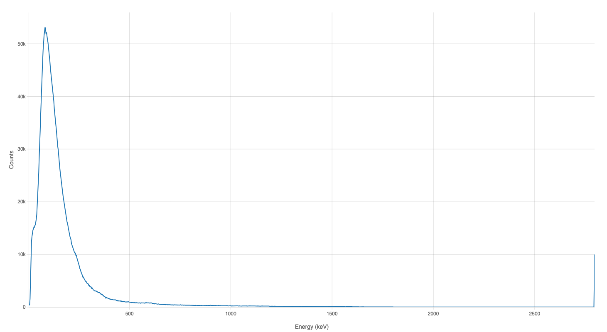

# Radiacode for Home Assistant

[](https://github.com/303Bryan/ha-radiacode/releases)
[](https://www.hacs.xyz/docs/faq/custom_repositories/)
[](LICENSE)

Monitor radiation, view gamma spectra, and control your Radiacode detector from Home Assistant. Connect through a local Bluetooth adapter or an [ESPHome Bluetooth proxy](https://esphome.io/components/bluetooth_proxy/).

- Dose rate, count rate, and accumulated dose.
- Gamma spectra with ready-to-use dashboard examples.
- Battery, temperature, and connection status.
- Display, sound, vibration, and alarm-threshold controls.

## Installation

Use Home Assistant **2026.9.4 or newer**.

### HACS

1. Open HACS → three-dot menu → **Custom repositories**.
2. Add `https://github.com/303Bryan/ha-radiacode` with category **Integration**.
3. Find **Radiacode** and download it.
4. Restart Home Assistant.
5. Go to **Settings → Devices & Services** and configure the discovered detector. If it does not appear, select **Add Integration → Radiacode** and enter its Bluetooth address.

### Manual

Copy `custom_components/radiacode/` from the [latest release](https://github.com/303Bryan/ha-radiacode/releases/latest) into Home Assistant's `config/custom_components/` directory. Restart Home Assistant, then add the integration under **Settings → Devices & Services**.

## Using Radiacode

Dose and count readings update every five seconds by default; spectra update once per minute. Adjust these intervals through the integration's **Configure** options. Set the spectrum interval to `0` to disable automatic spectrum reads.

To connect the Radiacode mobile app, turn off the **BLE Connection** switch in Home Assistant. Turn it back on when you want Home Assistant to reconnect.

## Spectrum dashboard



Install [Plotly Graph Card](https://github.com/dbuezas/lovelace-plotly-graph-card) through HACS. Add the YAML below as a **dashboard view**; in the full dashboard configuration, add it as an item under `views:`. Replace `sensor.radiacode_spectrum` with your detector's Spectrum entity ID.

```yaml
type: panel
path: radiacode-spectrum
title: RadiaCode Spectrum
cards:
  - type: custom:plotly-graph
    title: Gamma Spectrum
    refresh_interval: 60
    raw_plotly_config: true
    entities:
      - entity: sensor.radiacode_spectrum
        name: Counts
        type: scatter
        mode: lines
        x: |
          $fn ({ hass, getFromConfig }) => {
            const sensor = hass.states[getFromConfig('.entity')];
            if (!sensor || ['unknown', 'unavailable'].includes(sensor.state)) return [];
            const a = sensor.attributes;
            return (a.channels || []).map((_, ch) =>
              a.calibration_a0 + a.calibration_a1 * ch + a.calibration_a2 * ch * ch);
          }
        "y": |
          $fn ({ hass, getFromConfig }) => {
            const sensor = hass.states[getFromConfig('.entity')];
            if (!sensor || ['unknown', 'unavailable'].includes(sensor.state)) return [];
            return sensor.attributes.channels || [];
          }
        hovertemplate: '%{x:.1f} keV<br>%{y} counts<extra></extra>'
    layout:
      height: 800
      margin:
        t: 30
        b: 60
        l: 70
        r: 30
      xaxis:
        type: linear
        title:
          text: Energy (keV)
        autorange: true
      yaxis:
        title:
          text: Counts
        rangemode: tozero
show_icon_and_title: false
```

[Download the view YAML](examples/spectrum-panel.yaml), or use the [card-only example](examples/spectrum-card.yaml) in an existing dashboard view.

## Documentation and support

- [Entities, controls, and configuration](docs/usage.md)
- [Troubleshooting and Bluetooth proxy setup](docs/troubleshooting.md)
- [Release notes](CHANGELOG.md)
- [Contributing](CONTRIBUTING.md)
- [Report a problem](https://github.com/303Bryan/ha-radiacode/issues/new/choose)

## License

[MIT](LICENSE) © Bryan Fleming. Protocol implementation builds on work from [cdump/radiacode](https://github.com/cdump/radiacode) and [mkgeiger/RadiaCode](https://github.com/mkgeiger/RadiaCode).
